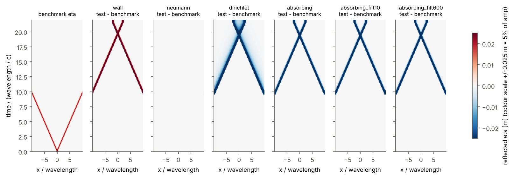
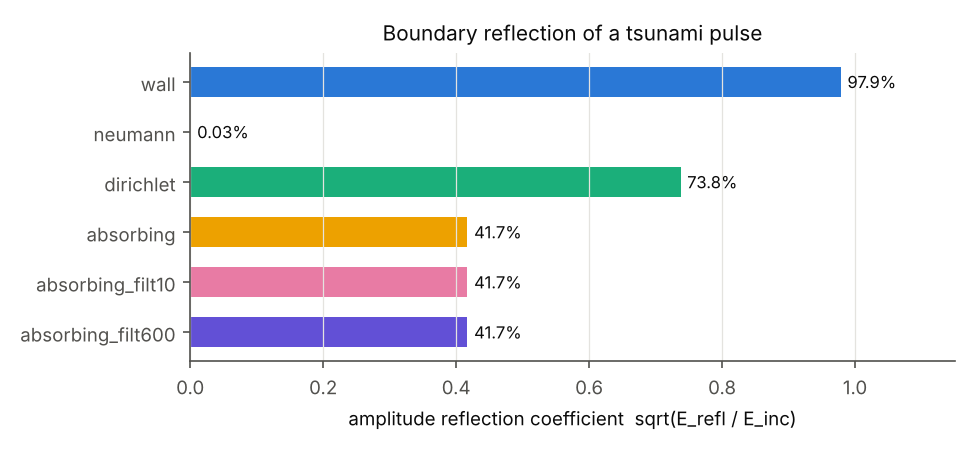
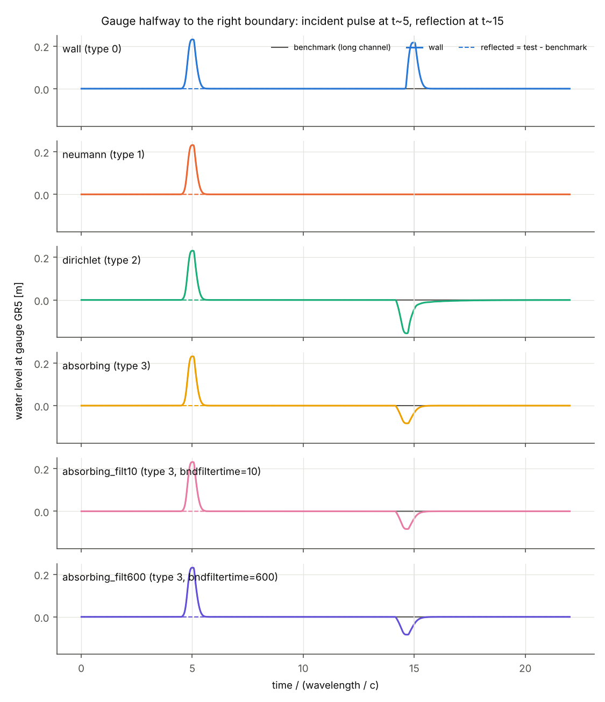
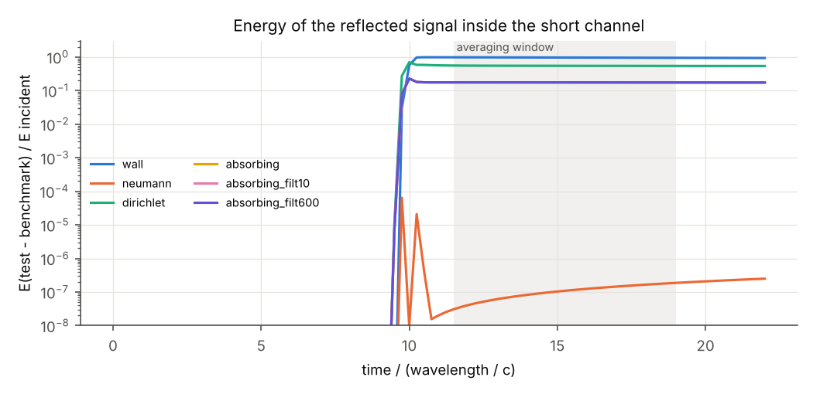

# Tsunami boundary reflection test

How much of a tsunami wave do BG_Flood's open boundaries reflect back into the
domain? This example measures it directly for each boundary type.

## Set-up



* Flat-bottom, frictionless rectangular channel, depth `h0 = 100 m`
  (long-wave speed `c = 31.3 m/s`).
* Initial condition: a Gaussian hump at rest in the middle of the channel,
  `eta0 = 0.5 exp(-x^2 / 2 sigma^2)`, `sigma = 1 km`. It splits into two
  identical pulses of amplitude 0.25 m (`a/h = 0.0025`, linear regime) that
  travel left and right.
* "Wavelength" of a pulse: `lambda = 6 sigma = 6 km` (its full extent),
  resolved by 60 cells (`dx = 100 m`).
* **Short channel** (the tests): the boundaries sit 10 wavelengths from the
  centre (120 km long). The same left/right boundary type is used on both
  ends, so every run gives two independent measurements.
* **Long channel** (the benchmark): twice as long. Its own end reflection
  can't re-enter the part of the channel used for the comparison before the run
  ends, so within the simulated time it is a reflection-free solution. It
  carries the same numerical diffusion and dispersion as the tests.
* The channel sides are rows of dry land (+10 m), not top/bot boundary
  conditions (see the note on boundary blocks below).
* Simulated time: 22 wavelength travel times (4214 s), long enough for the
  reflection to come back past the centre.

All of these values are at the top of `make_case.py` and can be changed. The
problem is linear and frictionless, so the results don't depend on the
absolute scale, only on the resolution (cells per wavelength).

### Scenarios

| scenario | `left`/`right` | notes |
|---|---|---|
| benchmark_long | 3 | 2x longer channel |
| wall | 0 | |
| neumann | 1 | default boundary |
| dirichlet | 2 | `zs = zsinit = 0` |
| absorbing | 3 | `zs = zsinit = 0`, default `bndfiltertime = 60`, `bndrelaxtime = 3600` |
| absorbing_filt10 | 3 | `bndfiltertime = 10` |
| absorbing_filt600 | 3 | `bndfiltertime = 600` |

## Running it

```bash
pip install numpy netCDF4 matplotlib
# GPU (default) or CPU (BG_GPU=-1). NJOBS runs several scenarios at once.
BG_FLOOD=/path/to/BG_Flood NJOBS=1 ./run_all.sh
```

`run_all.sh` calls `make_case.py`, which writes `runs/<scenario>/` (bathymetry,
hot-start file, `BG_param.txt`). It then runs BG_Flood in each folder and calls
`analyse.py`, which writes `results/`. On a 4-core CPU without a GPU the full
set takes about 50 minutes; a GPU takes a few minutes.

## How the reflection is measured

The reflected signal is `eta_refl = eta_test - eta_benchmark`. It is zero until
the pulse reaches the tested boundary.

* **Gauges** `GL5`/`GR5`, halfway between the centre and the boundaries: the
  incident pulse passes at `t = 5 lambda/c` and the reflection at
  `t = 15 lambda/c`, well separated.
  `R_amp = max|eta_refl| / max|eta_incident|`, signed: `+` is in phase (like a
  wall), `-` is inverted (like a fixed water level).
* **Energy**: `E = integral(g eta^2/2 + h u^2/2) dx` of the test-minus-benchmark
  fields over the short-channel extent. It is averaged once the incident pulses
  have fully left the channel and before the reflections reach the far ends,
  then divided by the incident energy, giving `R_E` and `sqrt(R_E)`. This also
  counts long-period residuals that a peak value misses, such as a water-level
  set-down left behind by the boundary.

A wall gives 0.94–0.98 instead of 1 because the reflected pulse has travelled
10 more wavelengths than the incident one and has been slightly damped by the
scheme. Read the other values relative to the wall.

## Results

Run on the CPU in double precision with `engine = 1`:

| scenario | bnd type | R_amp GL5 | R_amp GR5 | R_E (energy) | sqrt(R_E) | mean level change left behind [m] |
|---|---|---|---|---|---|---|
| wall | 0 | +0.937 | +0.938 | 0.958 | 0.979 | +1.0e-02 |
| neumann | 1 | +0.000 | +0.000 | ~1e-7 | ~3e-4 | -1.1e-05 |
| dirichlet | 2 | -0.685 | -0.677 | 0.544 | 0.738 | -1.0e-02 |
| absorbing | 3 | -0.360 | -0.361 | 0.174 | 0.417 | -5.2e-03 |
| absorbing_filt10 | 3 | -0.360 | -0.361 | 0.174 | 0.417 | -5.2e-03 |
| absorbing_filt600 | 3 | -0.360 | -0.361 | 0.174 | 0.417 | -5.2e-03 |





### Findings

* **Wall (0)**: full reflection, as expected. The total mass stays in the
  channel (+1.0e-2 m mean level = the initial hump's volume / channel length).
* **Neumann (1)**: practically transparent to a normally incident long wave.
  Copying the interior state into the ghost cell gives a trivial Riemann
  problem at the boundary face, so the outgoing wave leaves cleanly. Don't
  extend this to obliquely incident waves, or to waves that must come *in*
  through the boundary: Neumann can't force anything.
* **Dirichlet (2)**: strong inverted reflection (~70% in amplitude) followed by
  a slow tail. Holding the level fixed reflects the wave as a trough and drains
  about twice the hump's volume out of the domain.
* **Absorbing (3)**: about 36% inverted reflection in amplitude (17% in
  energy), and a net drawdown of about half the hump's volume. That's far more
  than a characteristic (Flather/Sommerfeld-type) condition should give for a
  1D linear wave at normal incidence. A diagnostic run with the imposed outflow mass flux
  (`q = sqrt(g h) (zs - zsbnd)` in `ABS1DQ`) halved still reflected an
  inverted pulse (-0.22). A plain flux-magnitude error would have made it
  positive, so the extra drawdown seems to come from how the boundary face's
  momentum flux / pressure is handled, not from the mass-flux formula itself.
  Not resolved yet.
* **`bndfiltertime` / `bndrelaxtime` have no effect**: the three absorbing runs
  are bit-identical. In `src/Boundary.cu` the filter factors are computed from
  `XParam.dt`, but `XParam.dt` is never updated from its initial value of 0;
  the time step lives in `XLoop.dt`. So `factime = 0` and `facrel = 1`, and
  `qmean` stays at 0 for the whole run. The `absorbing_filt*` scenarios are kept
  so this sensitivity test becomes meaningful once that is fixed.

### Note: boundary blocks in narrow domains

BG_Flood assigns each boundary *block* to a single boundary segment: the last
listed segment whose polygon touches it. All the block's open faces then get
that segment's type. In a channel only one block wide, `top = 0; bot = 0;`
listed after `left`/`right` therefore turns the left and right ends into
walls, and listed before them it puts the absorbing or Dirichlet condition on
the channel's lateral faces at the ends. That's why this example uses dry land
rows for the channel sides. Keep it in mind in any narrow domain, and at the
corners of normal domains.
